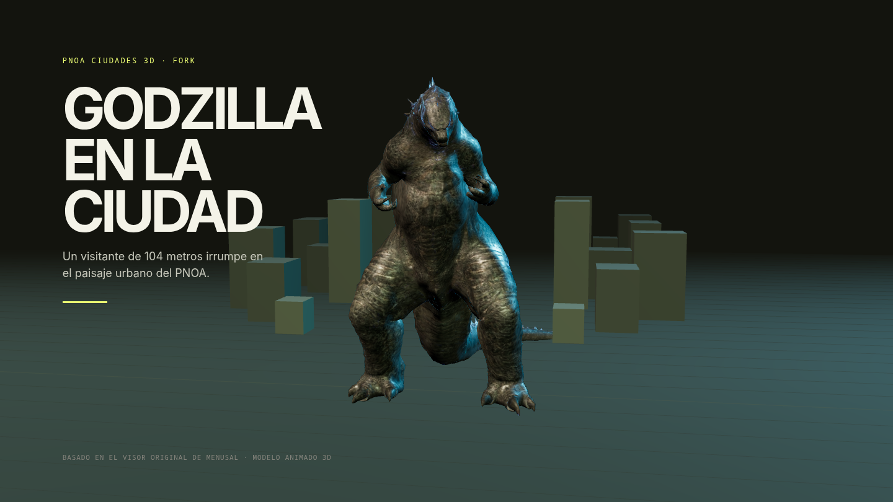

# PNOA Ciudades 3D

Visor web de los núcleos urbanos de España (≥50.000 habitantes) con **modelos 3D del PNOA** superpuestos sobre la **ortofoto de máxima actualidad** del IGN/CNIG, y un inventario de monumentos y edificios singulares obtenido de **Wikidata** y **Wikipedia**.

La navegación es guiada: se elige una ciudad desde el selector, se explora su inventario de lugares y se vuela hasta cada uno para orbitar alrededor del modelo 3D.

> **Este repositorio es un fork del proyecto [PNOA Ciudades 3D de menusal](https://github.com/menusal/pnoa-3d-map).** Esta versión añade a Godzilla animado junto al monumento seleccionado. Puedes visitar el proyecto original en el enlace.




## Demo

🔗 **https://pnoa-3d-map.vercel.app/**

## Qué es

- **Base cartográfica**: ortofoto del PNOA Máxima Actualidad servida por WMTS del IGN.
- **Modelos 3D**: tiles 3D (3D Tiles / GLTF) del PNOA servidos por la IDEE, renderizados con `deck.gl` sobre MapLibre GL JS.
- **Lugares de interés**: monumentos y edificios singulares consultados en Wikidata y enriquecidos con extractos e imágenes de Wikipedia.
- **Interacción**: selector de ciudad, panel de lugares, vuelo y órbita alrededor del monumento, Godzilla animado con Three.js, marcador con etiqueta y control manual de rotación.

## Cobertura y actualización

La disponibilidad de modelos 3D depende del catálogo del PNOA. En el momento de escribir esto, el servicio 3D cubre **Andalucía, Extremadura y la Región de Murcia** (vuelo PNOA 2025).

El proyecto **se irá actualizando conforme el IGN/CNIG publiquen nuevos vuelos y modelos 3D** en el catálogo. La lista de ciudades se construye en tiempo de ejecución a partir del propio catálogo, por lo que las nuevas zonas aparecerán automáticamente sin cambios de código.

- Catálogo de descargas del CNIG: <https://centrodedescargas.cnig.es/CentroDescargas/ortofoto-pnoa-maxima-actualidad>
- Portal PNOA (IGN): <https://pnoa.ign.es>
- Servicio 3D de la IDEE: <https://servicios3d.idee.es/pnoa-ma/json/tileset.json>

## Proceso de creación

1. **Descubrimiento de datos**. Se parte del tileset raíz del servicio 3D del PNOA (`servicios3d.idee.es/pnoa-ma`), que contiene un nodo por ciudad con su `boundingVolume`. En paralelo se consultan en Wikidata todos los municipios de España con población ≥50.000 habitantes (SPARQL, `query.wikidata.org`).
2. **Fusión de ciudades**. Se cruzan ambas fuentes por proximidad geográfica (distancia haversine < 10 km) para asignar a cada ciudad de Wikidata su `tileset.json` 3D cuando existe. Del `boundingVolume` (ECEF) se deriva un **bbox de cobertura** proyectando sus 8 esquinas a coordenadas geográficas.
3. **Visualización 3D**. Los tiles 3D se renderizan con `Tile3DLayer` de deck.gl en modo *interleaved* sobre MapLibre GL JS. Godzilla se carga desde el GLB local con Three.js y su animación se reproduce junto al monumento seleccionado.
4. **Interacción**. Al seleccionar una ciudad se vuela hasta ella; al elegir un lugar se vuela al monumento y comienza una órbita automática. El usuario puede pausarla y girar en pasos de 45°, o reanudarla. Un marcador (anillo, pulso, columna de luz y etiqueta) señala el lugar.
5. **Filtrado por cobertura**. Solo se muestran los lugares que caen dentro del bbox de cobertura 3D de la ciudad, indicando cuántos quedaron fuera.
6. **Rendimiento**. Caché de peticiones con TanStack Query, animación de la órbita y del marcador desacoplada del ciclo de render de React, ausencia de `backdrop-filter` sobre el canvas WebGL y control del nivel de detalle de los tiles.
7. **Diseño**. Interfaz construida sobre el sistema visual *INVERSA* (superficie oscura, tipografía editorial, mono para las anotaciones y un único acento lima).

## Stack

- [React](https://react.dev) + [Vite](https://vite.dev) + TypeScript
- [MapLibre GL JS](https://maplibre.org/maplibre-gl-js/docs/) — mapa base y ortofoto
- [deck.gl](https://deck.gl) + [loaders.gl](https://loaders.gl) — renderizado de tiles 3D
- [Three.js](https://threejs.org) — carga y animación del modelo GLB de Godzilla
- [TanStack Query](https://tanstack.com/query) — caché de datos
- [Tailwind CSS](https://tailwindcss.com) — estilos
- [lucide-react](https://lucide.dev) — iconografía

## Ejecución local

```bash
npm install
npm run dev      # servidor de desarrollo en http://localhost:5173
npm run build    # build de producción en dist/
npm run preview  # previsualiza el build
```

## Atribución y licencias

### Datos y cartografía

| Recurso | Titular | Licencia | Enlace |
| --- | --- | --- | --- |
| Ortofoto PNOA Máxima Actualidad | © Instituto Geográfico Nacional (IGN) / O.A. Centro Nacional de Información Geográfica (CNIG) | CC BY 4.0 | <https://centrodedescargas.cnig.es/CentroDescargas/ortofoto-pnoa-maxima-actualidad> |
| Modelos 3D del PNOA | IGN / CNIG, difundidos por la IDEE | CC BY 4.0 | <https://servicios3d.idee.es/pnoa-ma/json/tileset.json> |
| Lugares y datos estructurados | Wikidata | CC0 1.0 | <https://www.wikidata.org> |
| Extractos e imágenes | Wikipedia (es) / Wikimedia Commons | CC BY-SA 4.0 | <https://es.wikipedia.org> |

> La información del IGN/CNIG se usa conforme a la [licencia de uso](https://www.ign.es/resources/licencia/Condiciones_licenciaUso_IGN.pdf) (compatible con CC BY 4.0), que obliga a reconocer y mencionar su origen y propiedad.

### Modelo de Godzilla

El modelo `N3s G0dz!11@` es de [ArachnoBoy](https://sketchfab.com/vang807), publicado en [Sketchfab](https://sketchfab.com/3d-models/n3s-g0dz11-6004ce3f4d754da18039960f47dea690) con licencia [CC BY-NC-SA 4.0](https://creativecommons.org/licenses/by-nc-sa/4.0/). La imagen de portada se ha renderizado a partir de este modelo.

### Software y tipografías

| Recurso | Licencia | Enlace |
| --- | --- | --- |
| MapLibre GL JS | BSD-3-Clause | <https://github.com/maplibre/maplibre-gl-js> |
| deck.gl | MIT | <https://github.com/visgl/deck.gl> |
| loaders.gl | MIT | <https://github.com/visgl/loaders.gl> |
| Three.js | MIT | <https://github.com/mrdoob/three.js> |
| React | MIT | <https://github.com/facebook/react> |
| Vite | MIT | <https://github.com/vitejs/vite> |
| Tailwind CSS | MIT | <https://github.com/tailwindlabs/tailwindcss> |
| TanStack Query | MIT | <https://github.com/TanStack/query> |
| lucide | ISC | <https://github.com/lucide-icons/lucide> |
| Inter | SIL OFL 1.1 | <https://fonts.google.com/specimen/Inter> |
| JetBrains Mono | SIL OFL 1.1 | <https://fonts.google.com/specimen/JetBrains+Mono> |

## Créditos

Proyecto original creado por [menusal](https://github.com/menusal). Este fork añade Godzilla animado al [visor original](https://github.com/menusal/pnoa-3d-map). El código se distribuye bajo licencia MIT (ver [LICENSE](LICENSE)); los datos, la cartografía y el modelo 3D mantienen las licencias de sus respectivos titulares indicadas arriba.
